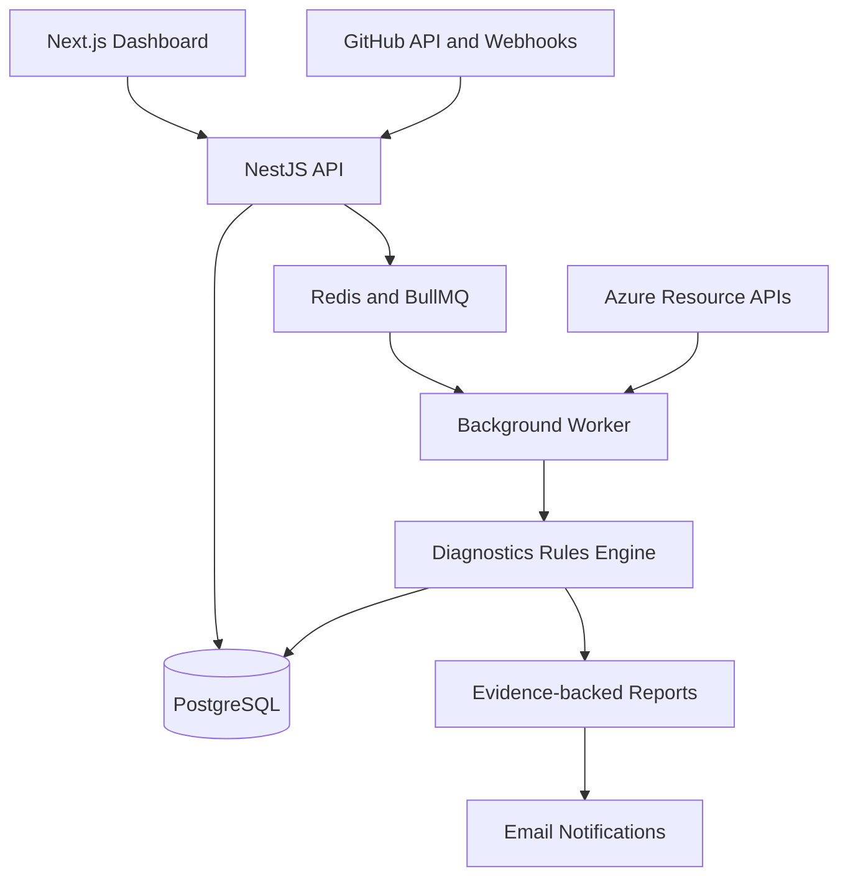

# ReleaseLens

## Project Requirements, Architecture, and Development Plan

**Project type:** Open-source developer tool  
**Primary positioning:** Backend Engineering, Azure Cloud, DevOps, and Full-Stack Engineering  
**Working name:** ReleaseLens  
**Status:** Proposed portfolio project  
**Initial deployment model:** Single-tenant, read-only MVP  
**Primary goal:** Demonstrate production-minded engineering through a tool that correlates source control, CI/CD, cloud deployment state, application health, and database migration status.

---

## 1. Executive Summary

ReleaseLens is a deployment intelligence and incident-diagnostics platform that helps engineering teams investigate why an application behaves differently across local, staging, and production environments.

It connects repository and deployment evidence to answer questions such as:

- Is the latest intended commit actually deployed?
- Which container image and revision are running?
- Did the CI/CD workflow succeed?
- Is the application healthy?
- Are expected database migrations present and applied?
- What changed immediately before an incident?
- Which conclusions are supported by evidence, and which remain hypotheses?

The MVP should be **read-only by default**. It must not automatically restart production services, run migrations, modify infrastructure, or change application configuration.

### Core value proposition

> ReleaseLens correlates source, build, deployment, health, and migration evidence into an actionable incident timeline, helping developers diagnose release problems faster.

### Why this project

The project demonstrates more than CRUD application development. It can show:

- Backend API design and asynchronous job processing
- Azure resource integration and cloud identity
- Docker image and revision inspection
- GitHub Actions and deployment pipeline analysis
- PostgreSQL data modelling and migration verification
- Security-conscious handling of credentials and logs
- Observability, testing, incident analysis, and technical documentation
- A usable full-stack product with a clear engineering purpose

ReleaseLens should complement existing cloud monitoring products rather than attempt to replace them.

---

## 2. Target Roles

Prioritize evidence that maps to these roles:

1. Backend Engineer
2. Cloud Engineer / Azure Engineer
3. DevOps Engineer
4. Platform Engineer / Developer Tools Engineer
5. Full-Stack Engineer

### Skills-to-evidence map

| Employer signal      | Evidence in ReleaseLens                                                                     |
| -------------------- | ------------------------------------------------------------------------------------------- |
| Backend architecture | Modular API, domain model, background workers, webhook processing                           |
| Database engineering | PostgreSQL schema, indexing, transaction handling, migration checks                         |
| Azure                | Managed identity or service principal integration, Container Apps inspection, health checks |
| DevOps               | CI/CD run inspection, image-to-commit correlation, deployment verification                  |
| Reliability          | Health probes, incident timelines, retries, timeouts, alerting, failure classification      |
| Security             | Least privilege, encrypted credentials, redaction, audit trails, tenant boundaries          |
| Full-stack delivery  | Accessible dashboard, API integration, loading/error states, responsive design              |
| Testing discipline   | Unit, integration, contract, end-to-end, and fault-injection tests                          |
| Product thinking     | A defined user problem, measured diagnostic workflow, clear limitations                     |

A portfolio project alone does not establish seniority or production experience. Its purpose is to provide credible, inspectable evidence of engineering judgment and execution.

---

## 3. Scope and Non-Goals

### MVP scope

- Connect one GitHub repository.
- Connect one Azure environment.
- Ingest GitHub Actions workflow events and deployment-related events.
- Inspect Azure Container Apps revisions and application health.
- Compare intended source commit, build artifact metadata, and deployed revision when that information is available.
- Display recent deployments and their outcomes.
- Run configurable read-only diagnostic checks.
- Inspect migration status for supported Prisma projects using a safe, explicitly configured mechanism.
- Create evidence-backed incident summaries.
- Send optional notifications.
- Provide a seeded demo environment with deliberately introduced faults.

### Explicit non-goals for the MVP

- Replacing Azure Monitor, Application Insights, GitHub Actions, or a full observability suite.
- Supporting every cloud provider or CI/CD platform.
- Running arbitrary shell commands on user infrastructure.
- Executing production database migrations.
- Automatically rolling back, restarting, or redeploying services.
- Claiming root cause when available evidence only supports a hypothesis.
- Storing raw application secrets or complete environment-variable values.
- Building complex multi-tenant billing before the core diagnostics work.

---

## 4. Primary User Journeys

### Journey A: Investigate a stale deployment

1. A developer opens a service in ReleaseLens.
2. ReleaseLens shows the latest repository commit and successful workflow.
3. The deployed Azure revision reports older image or commit metadata.
4. The diagnostics engine compares available evidence.
5. ReleaseLens flags a likely deployment mismatch, shows the relevant commits and revisions, and recommends verifying the image tag/digest and deployment workflow.

### Journey B: Investigate a database migration problem

1. A deployment is associated with a new release.
2. The release metadata indicates a migration was expected.
3. The configured read-only migration check reports a failed or unapplied migration, if that data is safely accessible.
4. ReleaseLens links the finding to the release and migration evidence.
5. The report clearly distinguishes observed facts from possible consequences.

### Journey C: Investigate an unhealthy application

1. A scheduled health check or Azure signal reports degraded health.
2. ReleaseLens records the time, service, revision, and response.
3. The system correlates the event with recent deployments and workflow runs.
4. The incident timeline shows the evidence in chronological order.
5. The user receives a concise diagnostic summary and suggested next checks.

### Journey D: Review environment differences

1. A developer selects staging and production.
2. ReleaseLens compares safe metadata: deployed commit, image digest, revision state, health status, migration status, and explicitly allowlisted configuration keys.
3. Secret values are never displayed.
4. Differences are categorized as expected, unexpected, or unknown based on explicit project policy rather than guesses.

---

## 5. Functional Requirements

### 5.1 Authentication and access

- Support secure user sign-in.
- Use role-based authorization for connected projects and integrations.
- Require explicit authorization before connecting GitHub or Azure.
- Validate authorization on the server for every protected operation.
- Record security-sensitive actions in an audit log.
- Support revoking an integration and deleting its stored credentials.

### 5.2 GitHub integration

- Connect a repository using the minimum permissions available for the selected features.
- Receive GitHub webhooks with signature verification.
- Process workflow run, workflow job, push, and deployment-related events where supported.
- Record commit SHA, branch, workflow name, run status, timestamps, and links.
- Handle webhook retries and duplicate delivery idempotently.
- Provide a polling/reconciliation path for missed webhook events.
- Never treat a branch name or mutable image tag as sufficient proof of deployed source identity.

### 5.3 Azure integration

- Begin with Azure Container Apps.
- Read deployment revisions, revision status, configured image reference, relevant resource metadata, and health information available through authorized Azure APIs.
- Prefer managed identity for workloads hosted in Azure. For external deployments, support a narrowly scoped service principal or equivalent supported identity.
- Document required Azure roles and permissions.
- Handle Azure API throttling, expired credentials, permission errors, and transient failures.
- Show the last successful sync time and any data that could not be retrieved.
- Do not expose credentials, connection strings, or secret values in logs or API responses.

### 5.4 Deployment correlation

- Correlate repository commit, CI workflow run, build artifact, and deployed revision using immutable identifiers where possible.
- Prefer image digests and embedded build metadata over mutable image tags.
- Represent unknown relationships as **unverified**, not as success or failure.
- Detect stale deployment evidence, missing metadata, failed workflows, and revisions that are not healthy.
- Retain enough history to show changes over time.

### 5.5 Health checks

- Support configurable HTTP health endpoints.
- Configure timeouts, expected status codes, and safe retry behavior.
- Store timestamp, duration, status, and a bounded, redacted response summary.
- Avoid sending sensitive headers or request bodies.
- Clearly distinguish a failed health check from proof that the entire service is down.

### 5.6 Database migration checks

- Start with Prisma migration metadata as the first supported adapter.
- Use a dedicated, read-only diagnostic connection wherever feasible.
- Inspect migration metadata only through a documented and tested mechanism.
- Do not execute `migrate deploy`, schema changes, destructive queries, or arbitrary SQL from the diagnostics engine.
- Report unsupported migration systems as unsupported rather than guessing.
- Explain when a check is incomplete because permissions or connectivity are insufficient.

### 5.7 Diagnostics engine

Each diagnostic finding should include:

- Finding ID and category
- Severity and confidence
- Service and environment
- Detection time
- Observed evidence and timestamps
- Relevant source links or resource identifiers
- Explanation of why the evidence matters
- Recommended next verification step
- Clear distinction between fact, inference, and unknown
- Resolution state and audit history

Use deterministic rules for the first version. Add an optional AI summary layer only after evidence collection and redaction are reliable.

### 5.8 Incident timeline and reports

- Show deployment, workflow, health, migration, and diagnostic events chronologically.
- Filter by service, environment, severity, and time range.
- Allow an incident report to be copied or exported as Markdown.
- Link findings to the underlying evidence.
- Preserve the time zone and original timestamps consistently.

### 5.9 Notifications

- Support email notifications first.
- Consider Slack or Telegram after the core workflow is stable.
- Avoid duplicate alerts for repeated observations of the same active finding.
- Include the finding, evidence summary, severity, and dashboard link.
- Never include secrets or sensitive payloads in notifications.

---

## 6. Proposed Technical Stack

Choose a stack that demonstrates depth without creating unnecessary operational overhead.

| Layer                  | Choice                                   | Reason                                                |
| ---------------------- | ---------------------------------------- | ----------------------------------------------------- |
| Frontend               | Next.js + TypeScript                     | Full-stack UI and maintainable component architecture |
| UI                     | Tailwind CSS + shadcn/ui                 | Consistent, responsive dashboard                      |
| Backend API            | NestJS + TypeScript                      | Modular backend, validation, guards, testing          |
| Database               | PostgreSQL                               | Relational data and reliable event history            |
| ORM                    | Prisma                                   | Typed database access and migration tooling           |
| Background jobs        | Redis + BullMQ                           | Scheduled checks, retries, asynchronous processing    |
| Integration            | GitHub REST API and webhooks             | Workflow and repository events                        |
| Cloud integration      | Azure SDK for JavaScript                 | Azure resource and revision inspection                |
| Containers             | Docker / Docker Compose                  | Reproducible local development                        |
| CI/CD                  | GitHub Actions                           | Test, build, scan, and deployment workflows           |
| Infrastructure as code | Bicep initially; Terraform optional      | Repeatable Azure infrastructure                       |
| Testing                | Jest, Supertest, Playwright              | Unit, API integration, and end-to-end coverage        |
| Observability          | OpenTelemetry-compatible instrumentation | Traces, metrics, and structured logs                  |
| Documentation          | Markdown, diagrams, OpenAPI              | Reviewable architecture and API contracts             |

### Suggested monorepo structure

```text
releaselens/
├── apps/
│   ├── web/                 # Next.js dashboard
│   ├── api/                 # NestJS API
│   └── worker/              # Background jobs and scheduled checks
├── packages/
│   ├── contracts/           # Shared schemas and API types
│   ├── diagnostics/         # Rules and finding model
│   ├── integrations/        # GitHub and Azure adapters
│   └── config/              # Shared linting and TypeScript config
├── infra/
│   ├── docker/
│   └── azure/               # Bicep templates
├── tests/
│   ├── integration/
│   ├── e2e/
│   └── fixtures/            # Synthetic logs, events, and fault scenarios
├── docs/
│   ├── architecture.md
│   ├── security.md
│   ├── threat-model.md
│   ├── runbook.md
│   └── decisions/
├── docker-compose.yml
├── .env.example
└── README.md
```

This structure is a proposal, not a requirement to introduce every package on day one. Keep the first release small enough to finish.

---

## 7. High-Level Architecture



### Design principles

- Keep integrations behind adapters so the diagnostic rules are not coupled to a single provider.
- Treat webhooks as at-least-once delivery and make event processing idempotent.
- Use background jobs for cloud API calls and scheduled health checks.
- Keep request handlers short and bounded by timeouts.
- Persist normalized events and references to source evidence.
- Use explicit status values such as `healthy`, `degraded`, `failed`, `unknown`, and `unverified`.
- Make diagnostics reproducible from stored evidence wherever possible.
- Keep the UI separate from privileged integration credentials and cloud access.

---

## 8. Data Model

Start with these entities and evolve only when actual requirements demand it.

### Core entities

- `User`: authenticated account.
- `Organization`: ownership boundary, even if the first deployment has only one organization.
- `Membership`: user role within an organization.
- `Project`: connected application or repository.
- `Environment`: staging, production, or another named environment.
- `Integration`: provider, status, scopes, credential reference, last successful sync.
- `WorkflowRun`: repository, commit, status, start/end timestamps, source URL.
- `Artifact`: immutable image digest where available, build metadata, associated workflow.
- `Deployment`: environment, revision, artifact, commit association, deployment timestamps.
- `HealthCheck`: target configuration, result, duration, observed timestamp.
- `MigrationCheck`: adapter, result, migration summary, check timestamp.
- `DiagnosticFinding`: rule, severity, confidence, evidence references, state.
- `Incident`: grouped findings and timeline.
- `AuditEvent`: security-sensitive actions and integration changes.
- `Notification`: destination reference, delivery state, retry count.

### Data rules

- Use stable IDs and foreign keys.
- Add unique constraints for provider event IDs and webhook delivery IDs where applicable.
- Store timestamps in UTC and render in the user's chosen time zone.
- Avoid persisting full logs when a bounded, redacted excerpt and source link are sufficient.
- Never store raw secret values in diagnostic findings.
- Define retention periods for events, logs, and audit records.
- Keep organization and project ownership checks in the backend, not only in the frontend.

---

## 9. Diagnostics Rules for the MVP

Start with transparent, testable rules. Example rules:

| Rule                         | Evidence                                                              | Result                                        |
| ---------------------------- | --------------------------------------------------------------------- | --------------------------------------------- |
| Deployed revision is stale   | Desired commit differs from verified deployed commit                  | Warning or high severity, depending on policy |
| Workflow failed              | GitHub reports a failed workflow associated with the intended release | Warning                                       |
| Health endpoint failing      | Configured endpoint fails repeated checks                             | Degraded service finding                      |
| Image identity is unknown    | Deployment has only a mutable tag and no build metadata               | Unverified deployment identity                |
| Migration check failed       | Supported adapter reports a failed migration state                    | High severity, with evidence                  |
| Environment metadata differs | Explicitly allowlisted, non-secret values differ from policy          | Configuration difference                      |
| Azure data is stale          | Last successful sync exceeds configured freshness threshold           | Data freshness warning                        |

Do not infer a root cause from timing alone. For example, a health failure after deployment is a correlation, not proof that the deployment caused the failure.

Every rule needs unit tests for positive cases, negative cases, missing data, stale data, and API errors.

---

## 10. Security and Reliability Requirements

Security is a core part of the project, not a final polish task.

### Credentials and permissions

- Prefer short-lived identity-based access where supported.
- Request the minimum permissions necessary.
- Encrypt any stored integration credentials using a managed key service in deployed environments.
- Never commit credentials or production configuration.
- Keep `.env.example` free of real values.
- Support revocation and credential rotation.
- Avoid exposing integration tokens to the frontend.

### Data protection

- Redact tokens, passwords, connection strings, authorization headers, and common secret patterns from logs.
- Apply request-size limits and validate all inbound webhook payloads.
- Verify webhook signatures and reject invalid payloads.
- Protect against SSRF in health-check URLs: restrict schemes, validate destinations, block loopback/private/link-local ranges unless explicitly and safely configured, and revalidate redirects.
- Apply rate limits and bounded timeouts to API and diagnostic operations.
- Enforce project and organization access checks on every request.
- Use audit events for integration connections, permission changes, and credential removal.

### Reliability

- Implement bounded retries with exponential backoff and jitter.
- Use idempotency for webhook and job processing.
- Handle rate limits and transient provider failures.
- Make stale or unavailable evidence visible rather than silently treating it as healthy.
- Add database backups and document recovery for the deployed demo.
- Add health endpoints for ReleaseLens itself.
- Use structured logs and correlation IDs.
- Define sensible timeouts and job concurrency limits.

### AI safeguards

If AI summaries are added:

- Send only the minimum redacted evidence required.
- Do not send secret values or complete environment dumps.
- Require summaries to reference evidence IDs.
- Label inferred causes as hypotheses.
- Do not allow the model to run commands or change cloud resources.
- Provide a deterministic, non-AI diagnostic path when AI is unavailable.

---

## 11. Testing Strategy

A strong portfolio project must prove its behavior, not only show a demo.

### Unit tests

- Each diagnostic rule
- Evidence correlation logic
- Severity and confidence mapping
- Redaction utilities
- Permission checks
- Webhook signature validation
- Idempotency behavior

### Integration tests

- PostgreSQL persistence and constraints
- Redis/BullMQ job processing
- GitHub adapter using mocked API responses
- Azure adapter using mocked SDK responses
- Provider errors, timeouts, rate limits, and retries
- Migration-check adapter with safe test databases

### End-to-end tests

- Sign in and connect a demo project
- View deployment history
- Inspect a stale deployment finding
- Review evidence and export a report
- Confirm unauthorized users cannot access another project's data

### Fault-injection scenarios

Create a disposable demo application and deliberately introduce:

1. A stale image deployment.
2. A failed CI workflow.
3. A broken health endpoint.
4. Missing build metadata.
5. An unapplied Prisma migration in a disposable database.
6. A simulated Azure API timeout.
7. A duplicated webhook delivery.
8. A secret-like value in a synthetic log to verify redaction.

Document expected results and show automated tests proving that each case is handled correctly.

---

## 12. Delivery Plan

This plan assumes a focused MVP and should be adjusted based on weekly availability. It is not a promise that every integration will be production-ready within a fixed number of days.

### Phase 0 — Define the problem

Deliverables:

- One-page product brief
- User journeys and MVP boundary
- Threat model
- Initial architecture diagram
- First three diagnostic rules
- Synthetic fixture data

**Exit criteria:** The core use case is narrow and testable.

### Phase 1 — Foundation

Deliverables:

- Monorepo and development scripts
- Docker Compose for local services
- PostgreSQL schema and migrations
- Authentication and authorization
- Basic dashboard
- NestJS API conventions
- CI workflow for linting, tests, and builds

**Exit criteria:** A user can sign in and view a seeded project with deterministic deployment history.

### Phase 2 — GitHub integration

Deliverables:

- Repository authorization
- Verified webhook ingestion
- Workflow run and commit history
- Duplicate delivery protection
- Event reconciliation
- Integration error states

**Exit criteria:** A repository event appears once and can be traced to its source.

### Phase 3 — Azure integration

Deliverables:

- Azure Container Apps read-only adapter
- Revision and image-reference inspection
- Identity and permission documentation
- Sync status and error handling
- Service health-check configuration

**Exit criteria:** The dashboard shows authorized Azure state and honestly identifies missing or stale data.

### Phase 4 — Diagnostics engine

Deliverables:

- Versioned diagnostic rules
- Evidence model
- Stale-deployment detection
- Health-check findings
- Unknown image identity finding
- Incident timeline
- Markdown report export

**Exit criteria:** Fault-injection scenarios generate the expected findings with linked evidence.

### Phase 5 — Migration checks and alerts

Deliverables:

- Safe Prisma migration status adapter
- Email notifications
- Duplicate-alert suppression
- Incident status transitions
- Security and retention review

**Exit criteria:** The tool reports migration state without executing migrations or exposing secrets.

### Phase 6 — Public portfolio release

Deliverables:

- Public repository with an appropriate open-source license
- Live demo using synthetic data
- Optional isolated Azure demonstration environment
- Architecture and threat-model documents
- API documentation
- Test and CI status
- Short technical walkthrough
- Known limitations and roadmap

**Exit criteria:** A reviewer can understand the problem, run the project, inspect tests, and reproduce at least three diagnostic scenarios.

---

## 13. Deployment Plan and Cost Discipline

Avoid building expensive infrastructure before the product works locally.

### Local development

Use Docker Compose for:

- Next.js frontend
- NestJS API
- Worker
- PostgreSQL
- Redis
- Optional Mailpit or another local email catcher

### Public demo

- Host the frontend and API on a cost-conscious platform suitable for long-running processes and background jobs.
- Use managed PostgreSQL and Redis only when justified by the deployment model.
- If using Azure Container Apps, set appropriate scaling and minimum replica behavior for background jobs.
- Keep a separate disposable Azure environment for integration demonstrations.
- Use budget alerts and resource cleanup procedures.
- Do not promise a permanently free deployment without verifying the current provider pricing and limits.

### Production-style evidence

Include:

- Infrastructure-as-code files
- Environment-variable reference
- Health and readiness probes
- Database migration procedure
- Backup and restore instructions
- Deployment workflow
- Rollback procedure documented for the demo application
- Cost and security notes

The demo should use synthetic or explicitly authorized data. Never publish client credentials, private logs, production identifiers, or proprietary application code.

---

## 14. Success Metrics

Measure engineering quality rather than vanity metrics.

- **Diagnostic correctness:** proportion of seeded fault scenarios correctly classified.
- **False-positive rate:** proportion of findings that are not supported by the test evidence.
- **Evidence completeness:** proportion of findings with useful evidence and timestamps.
- **Event idempotency:** duplicate webhook deliveries do not create duplicate logical events.
- **Failure transparency:** provider failures appear as unknown or stale data rather than false health.
- **Test coverage of critical rules:** every published rule has positive, negative, and missing-data tests.
- **Setup time:** a new developer can run the demo using documented steps.
- **Reproducibility:** a reviewer can repeat the documented fault scenarios.
- **Security validation:** automated tests cover redaction, access boundaries, webhook verification, and unsafe health-check targets.

Avoid claiming a percentage reduction in incident-resolution time unless it has been measured in a documented, repeatable comparison.

---

## 15. README and Portfolio Presentation

The repository README should include:

1. The problem and intended user.
2. A short demo video or GIF.
3. Screenshots of the incident timeline and evidence panel.
4. Architecture diagram.
5. Technology choices and trade-offs.
6. Local setup instructions.
7. Environment-variable reference.
8. Test commands and CI status.
9. Example fault scenarios and expected findings.
10. Security model and permissions.
11. Limitations and future work.
12. Contribution instructions and license.

### Suggested portfolio case-study structure

- **Problem:** deployment evidence is spread across source control, CI/CD, cloud resources, and database tooling.
- **Approach:** correlate those systems through normalized events and transparent diagnostic rules.
- **Engineering challenges:** webhook idempotency, immutable artifact identity, cloud permissions, stale data, and secret redaction.
- **Validation:** automated tests and repeatable fault-injection scenarios.
- **Outcome:** report measured test results and demonstrate the product. Do not invent business impact or users.

### Suggested CV bullet after the work is complete

> Built ReleaseLens, an open-source deployment diagnostics platform using TypeScript, NestJS, PostgreSQL, Docker, GitHub Actions, and Azure APIs to correlate CI/CD events, container revisions, health checks, and database migration evidence. Implemented secure webhook ingestion, asynchronous jobs, evidence-linked diagnostic rules, and automated fault-injection tests.

Only retain claims that are actually implemented and verifiable. Add real metrics when measured.

---

## 16. Development Priorities

When time is limited, use this order:

1. Build a deterministic diagnostic engine with synthetic fixtures.
2. Implement the deployment and incident data model.
3. Add GitHub workflow ingestion.
4. Add Azure Container Apps inspection.
5. Add health checks and deployment correlation.
6. Add migration checks.
7. Harden credentials, permissions, and redaction.
8. Add the dashboard, reports, and notifications.
9. Publish tests, docs, and a reproducible demo.
10. Add AI summaries only if they improve the evidence-based workflow.

Do not start by building a sophisticated AI agent, multi-cloud support, billing, or a large dashboard. Those features add complexity before the core product is proven.

---

## 17. Definition of Done

ReleaseLens is ready to be presented to employers when:

- [ ] A reviewer can run the project from the README.
- [ ] The core services run locally using documented commands.
- [ ] GitHub workflow events are ingested securely and idempotently.
- [ ] Azure deployment state is retrieved through documented permissions.
- [ ] Deployment identity is verified where evidence permits and marked unknown otherwise.
- [ ] At least three fault scenarios are reproduced automatically.
- [ ] Every diagnostic finding links to evidence and distinguishes facts from hypotheses.
- [ ] Database migration inspection is read-only.
- [ ] Secrets are redacted from logs, reports, and notifications.
- [ ] Authorization boundaries are tested.
- [ ] CI runs linting, tests, and builds.
- [ ] The architecture, threat model, setup, and limitations are documented.
- [ ] The portfolio demonstration uses synthetic or authorized data.
- [ ] No claims about performance improvements or adoption are made without evidence.

---

## 18. Final Recommendation

Treat ReleaseLens as an engineering portfolio project with a narrow, credible MVP. Its differentiator is not the dashboard or the use of AI. It is the quality of its deployment correlation, evidence model, security controls, tests, and operational documentation.

Build a small system that reliably detects a few real deployment problems before expanding its scope. That gives backend, Azure, DevOps, platform, and full-stack reviewers concrete evidence of how you design, implement, test, secure, and explain software.
