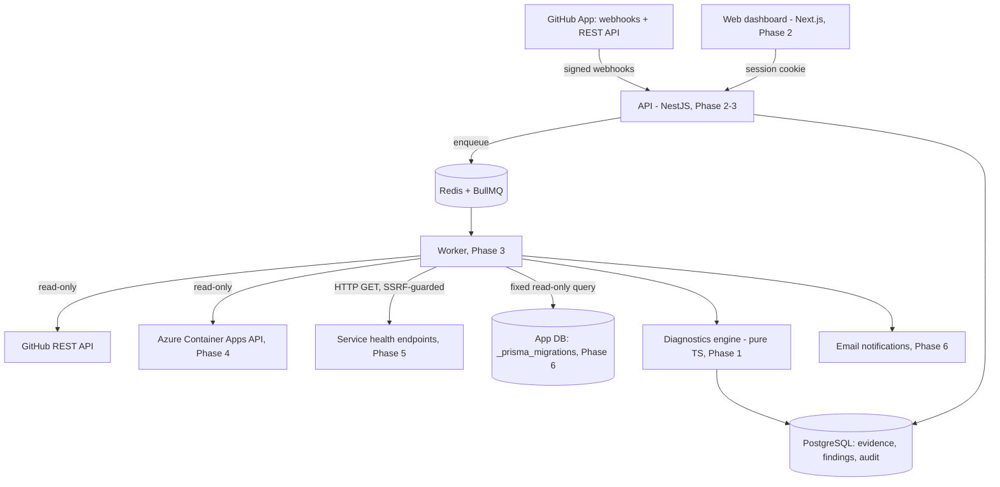

# Architecture

> Living document. It describes the target MVP architecture; components are marked with the phase that introduces them.

## Overview

## Components

| Component               | Responsibility                                                                                    | Holds credentials?                                                               |
| ----------------------- | ------------------------------------------------------------------------------------------------- | -------------------------------------------------------------------------------- |
| `apps/web`              | Dashboard UI. Talks only to the API.                                                              | No. Session cookie only.                                                         |
| `apps/api`              | Auth, authorization, REST API, webhook intake (verify, store delivery ID, enqueue, return fast).  | GitHub App webhook secret, OAuth client secret                                   |
| `apps/worker`           | All calls to external providers, scheduled checks, running the diagnostics engine, notifications. | GitHub App private key, Azure identity, migration-check DB read-only credentials |
| `packages/diagnostics`  | Deterministic rules: snapshot in, findings out. No I/O.                                           | No                                                                               |
| `packages/contracts`    | Shared schemas for evidence, findings, and API payloads.                                          | No                                                                               |
| `packages/integrations` | Provider adapters behind interfaces, plus fake implementations for demo mode.                     | No (receives clients from the worker)                                            |

## Key flows

**Webhook ingestion.** GitHub → API verifies the HMAC signature on the raw body → inserts the delivery ID (unique constraint; a duplicate is acknowledged and dropped) → enqueues a job → returns 202. The worker normalizes the event and upserts by provider IDs.

**Reconciliation.** A scheduled worker job lists recent workflow runs and deployed revisions to fill gaps from missed webhooks. Each integration records `lastSuccessfulSyncAt` and `lastError`.

**Diagnosis.** When new evidence arrives, the worker builds a snapshot for the affected service and environment, runs the rule registry, and upserts findings keyed by a fingerprint (rule ID + subject), so repeated observations update one finding instead of creating many.

**Sign-in and access (Phase 2).** The browser only talks to the dashboard origin; `/api/*` is proxied to the API. GitHub OAuth (with `state` and PKCE) or the demo login creates a server-side session; the cookie holds a random token and the database stores only its hash. Global guards run on every request: rate limit → origin check for non-GET requests → session. Project routes resolve `org + project + user` in one query and return 404 for anything the user cannot see. See [decision 0005](decisions/0005-sessions-csrf-and-access-control.md).

**Evidence storage and evaluation (Phase 2).** `packages/db` stores evidence in PostgreSQL, rebuilds a validated `DiagnosticSnapshot` from it, runs the rules, and upserts findings by fingerprint. Findings that stop firing are resolved; resolved findings that fire again reopen; acknowledged findings stay acknowledged.

## Provider interfaces

Every external system is reached through an interface with at least two implementations: the real adapter and a fake used in demo mode and tests.

- `SourceControlProvider`: GitHub
- `DeploymentTargetProvider`: Azure Container Apps
- `HealthProbe`: HTTP
- `MigrationInspector`: Prisma

## Principles

- Read-only towards every external system.
- Webhooks are at-least-once; all processing is idempotent.
- Missing or stale data surfaces as `unknown` or `unverified`.
- Diagnostics are reproducible from stored evidence.
- The browser never sees provider credentials.
